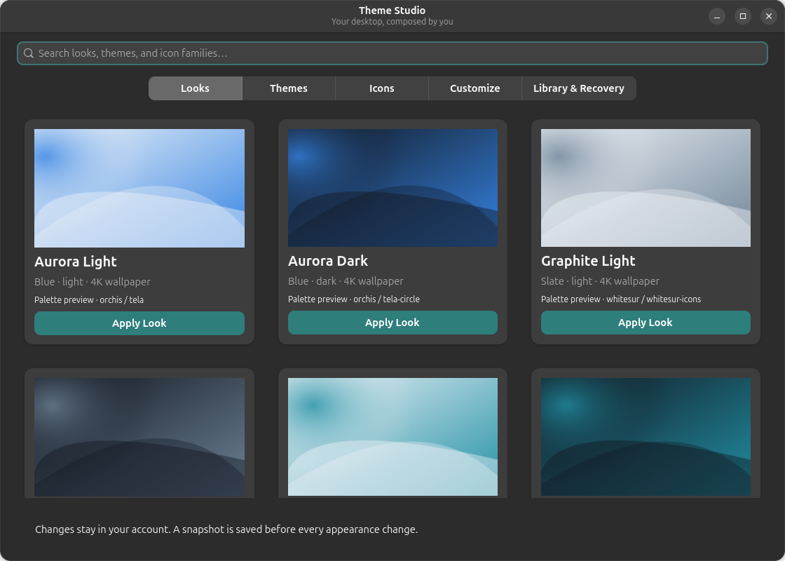

# RTD Theme Studio

[Back to Modules](../README.md) · [Tool Reference](../../docs/TOOLS.md) · [Research and feature mapping](REFERENCES.md)

An independent GTK4/Libadwaita GNOME appearance studio, inspired by the public LinuxTex ThemeStudio feature description. It provides a visual look gallery, searchable community theme and icon catalogs, a component mixer, saved looks, and reversible user-local changes. It does not contain the paid application's code, screenshots, or wallpapers.



## Launch

From the checkout:

```bash
./modules/Theme_Studio/rtd-theme-studio
```

After RTD registers the module commands:

```bash
rtd-theme-studio
rtd-theme-studio --terminal
rtd-theme-studio --help
```

Run as your logged-in GNOME desktop user, without sudo. At startup, Theme Studio checks its runtime, graphical, isolated-build, rendering, and GNOME Shell theme requirements. When resolvable components are missing, it explains what is needed, asks permission, and uses the RTD dependency installer plus the system package manager to install them. Only the dependency helper is elevated, and it exits after installing system packages; downloads, isolated builds, theme copies, and desktop-setting changes run as the logged-in user. An upstream installer's `/output` path is a temporary Bubblewrap staging mount, not root's home or a system theme directory. Existing RTD registration discovers the executable automatically. Use **Library & Recovery → Add Theme Studio to app grid** for a user-local desktop launcher.

## Features

- **30 original RTD looks** pair community GTK/icon families with appearance preferences, native accents where supported, Shell styling where provided, and original 3840×2160 SVG wallpapers. Applying a look installs missing families first. Previews depict the wallpaper/palette, not a screenshot of the resulting desktop.
- **16 GTK families and 17 icon families**, pinned to Git commits. The extra GTK family includes Catppuccin alongside Orchis, WhiteSur, Colloid, Graphite, Fluent, Layan, Qogir, Matcha, Mojave, Nordic, Dracula, Everforest, Gruvbox, Rose Pine, and Tokyo Night.
- **Build profiles** expose supported upstream options, including all colors, compact, compact with all colors, solid, and WhiteSur high-definition. Available profiles depend on the family. Default installation includes the upstream default variants; **Customize** lists the actual installed GTK/Shell/icon/cursor variants. Reset/remove a family before installing it with a different profile.
- **Component mixing** controls GTK3, Shell, icons, installed cursors, light/dark preference, native GNOME accents, and custom wallpapers. Theme names, accent support, and write permissions are checked before appearance changes.
- **Optional GTK4/Libadwaita CSS** imports a selected theme's GTK4 styles, preserving the original configuration and each prior state. Themes must supply GTK4 CSS. Restart open applications after changing it.
- **Saved looks** capture selected components, wallpaper, mode, accent, GTK4 override use, and managed family/build-profile dependencies. Reapplying a saved look installs missing managed families.
- **Undo and crash recovery**, Ubuntu/Yaru reset, distribution-default reset, active-theme protection, and removal restricted to assets installed by this module.
- Both a graphical interface and an interactive terminal menu use the same backend. Scriptable commands emit clear errors and nonzero status on failure; list commands emit JSON.

The paid product advertises exactly 1,057 variants. Its manifest is unavailable publicly; this module does **not** claim that count. Catalog families and build profiles are real upstream integrations, and installed variant totals are measured from disk. Some dark-only families retain their dark artwork even when GNOME's application appearance preference is light.

## Requirements

- Linux with GNOME; Python 3.10+ and Python GObject bindings (`gi`, Gio/GLib).
- GUI: GTK4 and Libadwaita introspection bindings and a graphical display.
- Source builds: Bubblewrap (`bwrap`) with unprivileged namespaces, Bash, standard Unix build tools, and `sassc` for GTK source themes. The sanitized build environment supplies `TERM=dumb` for upstream scripts that use terminal helpers. WhiteSur also requires `glib-compile-resources` and `xmllint`. Some upstream themes require Murrine and gnome-themes-extra for rendering.
- Internet access to GitHub's codeload service when installing a family. Applying installed components works offline.
- Shell themes: the launcher installs the distribution's GNOME **User Themes** extension package when it is available, but the extension must also be enabled in the user's session. Newly enabled extensions may require logout/login. The app reports this session prerequisite; it does not silently enable extensions or restart the Shell.
- GNOME 47+ for native accent colors. Complete looks retain the existing accent on earlier releases and report that limitation. Explicit unsupported accent requests fail before settings change.

The launcher resolves these requirements through `_rtd_library` on supported Debian/Ubuntu, Fedora/RHEL, and openSUSE/SUSE systems. It asks before changing system packages and verifies both packages and actual commands/imports afterward. If repository, package-manager, authorization, or distribution support prevents automatic installation, it reports the remaining capabilities and an exact distribution-appropriate command to try manually.

GTK4 overrides are not a stable Libadwaita theming API. Application and GNOME Shell compatibility depends on the upstream theme and GNOME version. Flatpak/Snap applications may use independent themes; this module does not broaden their filesystem permissions. KDE, XFCE, Cinnamon and GDM/login-screen customization are outside this GNOME user-session module.

## Command examples

```bash
rtd-theme-studio list catalog --search orchis
rtd-theme-studio list looks
rtd-theme-studio install orchis --profile compact-all-colors
rtd-theme-studio list installed
rtd-theme-studio apply --gtk Orchis-Dark --mode dark
rtd-theme-studio apply --gtk Orchis-Dark --gtk4
rtd-theme-studio apply --gtk Adwaita --gtk4-theme Orchis-Dark
rtd-theme-studio apply --shell ''
rtd-theme-studio apply --wallpaper "$HOME/Pictures/wallpaper.jpg"
rtd-theme-studio apply-look aurora-dark
rtd-theme-studio save-look my-workspace
rtd-theme-studio apply-look my-workspace
rtd-theme-studio undo
rtd-theme-studio reset --ubuntu
rtd-theme-studio reset
rtd-theme-studio uninstall orchis
rtd-theme-studio recover
rtd-theme-studio add-launcher
```

Variant names depend on the chosen profile. Use `list installed` before specifying them. Ubuntu reset requires installed Yaru GTK/icon themes; distribution reset uses the session's schema defaults. Resets affect only supported appearance keys, not all GNOME settings. Undo restores the last appearance snapshot; interrupted transactions must be recovered first.

## Files and recovery

The module respects absolute XDG data/config/state paths **inside the user's home**. With default paths:

| Location | Contents |
| --- | --- |
| `~/.local/share/themes/`, `~/.local/share/icons/` | Managed community assets |
| `~/.local/share/rtd-theme-studio/` | Generated wallpapers, saved looks, source notices and temporary builds |
| `~/.config/gtk-4.0/` | Optional GTK4 CSS import files |
| `~/.local/state/rtd-theme-studio/installed.json` | Ownership, source commit, download digest, build profile |
| `~/.local/state/rtd-theme-studio/history/` | Appearance and GTK4 snapshots |
| `~/.local/state/rtd-theme-studio/gtk4-original/` | Original GTK4 configuration before the first override |
| `~/.local/state/rtd-theme-studio/pending.json` | Interrupted appearance transaction pointer |
| `~/.local/share/applications/rtd-theme-studio.desktop` | Optional app-grid entry |

A snapshot is written before settings change. On an ordinary failure, the backend restores all captured settings and GTK4 files. After interruption, run `recover`; the pending marker prevents further appearance changes until recovery succeeds. Keep the state directory when troubleshooting. Snapshots are retained deliberately; deleting them removes the corresponding recovery ability.

Removal refuses active components and GTK4 references, never overwrites an existing theme directory, and never removes assets outside the managed themes/icons directories. Theme installs use bounded archive extraction, reject traversal and unknown external links, and compile scripts in a network-disabled Bubblewrap sandbox with a private home and read-only system mounts. Package managers/elevation commands are disabled inside the build sandbox. Legitimate internal links are preserved, dangling upstream links are omitted with a notice, and narrowly recorded upstream link corrections are applied before extraction. Upstream licenses/notices are saved with the installed source metadata.

Appearance rollback does not uninstall families downloaded for a look. A hard interruption during asset installation can leave unregistered partial assets; these are never silently overwritten. Inspect and remove such partial directories manually before retrying. Existing backups can refer to themes later removed explicitly; reinstall the family before restoring such a backup.

## Validation

```bash
python3 -m unittest discover -s modules/Theme_Studio/tests -v
python3 modules/Theme_Studio/tests/smoke_gtk.py
bash -n modules/Theme_Studio/rtd-theme-studio
```

Unit tests use temporary homes and simulated settings, covering transactional failures, recovery, concurrent operations, GTK4 preservation, protected removal, path validation, and archive handling. The GTK smoke test requires a display and opens the actual application with a temporary home and the GSettings memory backend; it does not alter desktop appearance. Online catalog/build validation is documented in [Validation](VALIDATION.md).
